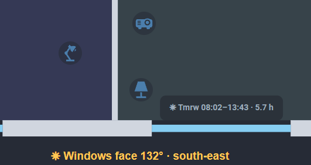

<p align="center"></p>

# Window Sun

[](https://my.home-assistant.io/redirect/hacs_repository/?owner=lmnhoshi&repository=ha-window-sun&category=integration)

A Home Assistant integration that tells you how many hours of **direct sun** each
window can get today. Once today's sun has left the window, it shows tomorrow's.

It uses your home location (Settings → System → General), the same one the Sun
integration uses. It needs no cloud service, no extra library and no polling.



*On a floor-plan dashboard: today's sun is over, so the label shows tomorrow's time slot and
total. The [dashboard example](#a-label-on-a-floor-plan) shows how to build it.*

## What counts as "sun on the window"


The sun hits a window when both of these are true:

1. **The sun is up.** This uses the Sun integration's definition of sunrise and sunset: the top of the disc is
   on the horizon, with standard refraction.
2. **The sun is in front of the wall, within the window's angle range.** The angle is measured
   from the wall as you look out. 0° is along the wall to your left, 90° is straight ahead,
   and 180° is along the wall to your right. The default range is **1° to 179°**, which leaves out
   the sun skimming along the façade. You can set each window's range yourself: see
   [Minimum and maximum angle](#minimum-and-maximum-angle).

**Obstacles are not taken into account.** Neighbouring buildings, trees, balconies, overhangs
and the window reveal are all ignored. The result is the *potential* sun time, an upper bound.

### Two periods in one day

Some windows get the sun twice in one day. For example, a north-facing window in a European summer
gets it early in the morning and again in the evening. All periods are listed, and the hours are their total.

## Setup

Go to **Settings → Devices & services → Add integration → Window Sun**. Add one entry per window, with these fields:

| Field | Meaning |
|---|---|
| Name | For example *Bedroom window*. Entities are named after it. |
| Orientation | The compass direction the window faces when you look out: 0 north, 90 east, 180 south, 270 west. Decimals are allowed. |
| Minimum angle from the wall | The lowest sun angle that still reaches the glass. Default 1°. |
| Maximum angle from the wall | The highest sun angle that still reaches the glass. Default 179°. |
| Floor | The floor the window is on, numbered the local way. |
| Ground floor number | **0**: the ground floor is 0, as in most of Europe. **1**: the ground floor is 1, as in North America. |

The orientation, the angles and the floor can be changed later with **Configure**.

### Minimum and maximum angle

Stand at the window and look out:

```
      left wall side                    right wall side
  0° ───────────────────── window ───────────────────── 180°
                  ╲          90°          ╱
                    ╲    straight ahead ╱
```

The sun reaches the glass only while its angle is between the minimum and the maximum.
Narrow the range when something always blocks one side, for example:

- **A deep reveal, or a side wall of a loggia.** On a window that faces 143°, with the sun
  blocked once it is less than 30° from the wall on the right, set the maximum to **150°**.
- **A building wing beside the window**, blocking the left side: raise the minimum.

The angles are horizontal directions only. They can't model obstacles that block the low sun
but not the high sun, such as a building in front.

The floor does **not** change the result yet, because no obstacles are modelled. With no obstacles
the sky is equally open on every floor. The floor is kept as attributes so that dashboards can use it,
and so that a future obstacle or horizon model can use it.

## Entities (per window)

| Entity | Example | Meaning |
|---|---|---|
| `sensor.<name>_sun_hours` | `4.7` h | Total direct sun for the day being shown |
| `sensor.<name>_sun_start` | timestamp | When the sun first reaches the window that day |
| `sensor.<name>_sun_end` | timestamp | When the sun last leaves the window that day |
| `sensor.<name>_sun_day` | `today` / `tomorrow` | Which day the values above describe |
| `binary_sensor.<name>_sun_on_window` | on / off | The sun is on the window right now |

`sun_start` and `sun_end` are *unknown* on a day without any sun on the window.

The sun-hours sensor has these attributes:
- `day` and `date`.
- `periods`, a list of `{start, end}`.
- `azimuth`, `facing` (for example `SE`), `min_angle`, `max_angle`, `floor`, `ground_floor_number`
  and `storeys_above_ground`.
  `storeys_above_ground` is the floor minus the ground floor number, so floor 3 counts as 2 above
  ground in the "ground floor is 1" convention.

### When the day switches

- **Today is shown** until the last moment of sun on the window today.
- **Tomorrow is shown** a second after that, and until midnight.
- **At midnight**, that same date becomes "today".
- **A window with no sun at all today** shows tomorrow straight away.

The integration recalculates at exactly these moments, and at every sun start and end. It also
recalculates when the home location changes.

## Dashboard examples

A tile:

```yaml
type: tile
entity: sensor.bedroom_window_sun_hours
name: Bedroom sun
state_content:
  - state
  - day
```

A one-line Markdown summary:

```yaml
type: markdown
content: >
  
  
  ☀️ **{{ states('sensor.' ~ w ~ '_sun_hours') }} h**
  {{ state_translated('sensor.' ~ w ~ '_sun_day') | lower }}
  
  · {{ as_timestamp(start) | timestamp_custom('%H:%M') }}–{{
  as_timestamp(states('sensor.' ~ w ~ '_sun_end')) | timestamp_custom('%H:%M') }}
  
```

### A label on a floor plan

The screenshot at the top is a `picture-elements` floor plan. A template sensor builds the
text, for example in a package:

```yaml
template:
  - sensor:
      - name: Living room window sun slot
        state: >
          
          
          
          
          
            {{ prefix }}No sun
          
            {{ prefix }}{{ as_timestamp(s) | timestamp_custom('%H:%M') }}–{{ as_timestamp(e) | timestamp_custom('%H:%M') }} · {{ states(w ~ 'hours') | float(0) | round(1) }} h
          
```

Two conditional elements then show it, gold while the sun is on the window and grey otherwise:

```yaml
- type: conditional
  conditions:
    - entity: binary_sensor.living_room_window_sun_on_window
      state: "on"
  elements:
    - type: state-label
      entity: sensor.living_room_window_sun_slot
      prefix: "☀ "
      style: { left: 57%, top: 90%, color: "#151B26", background: "#F2B84B",
               padding: 2px 8px, border-radius: 10px, white-space: nowrap }
- type: conditional
  conditions:
    - entity: binary_sensor.living_room_window_sun_on_window
      state: "off"
  elements:
    - type: state-label
      entity: sensor.living_room_window_sun_slot
      prefix: "☀ "
      style: { left: 57%, top: 90%, color: "#93A0AD", background: "rgba(21, 27, 38, 0.75)",
               padding: 2px 8px, border-radius: 10px, white-space: nowrap }
```

## How it is calculated

For each local day (midnight to midnight, so a daylight-saving day lasts 23 or 25 h), the
sun's position is computed with [astral](https://github.com/sffjunkie/astral):
- The position is sampled every 2 minutes.
- Each change between "sun on window" and "not" is then pinned down to the second by bisection.

Two days for one window take about 10 ms.

## Installation

Use the Marketplace or HACS: use the button at the top, or add `https://github.com/lmnhoshi/ha-window-sun`
as a custom repository of type *Integration*. Then install **Window Sun**. Alternatively, copy `custom_components/window_sun` into your configuration's
`custom_components` folder. Then restart Home Assistant.

## Development

```sh
python -m venv .venv && .venv/bin/pip install -r requirements_test.txt
.venv/bin/pytest
```

The tests check the geometry against astral's sunrise and sunset for Bordeaux. They cover
winter, summer and the daylight-saving day, and the switch from today to tomorrow.

## License

MIT
